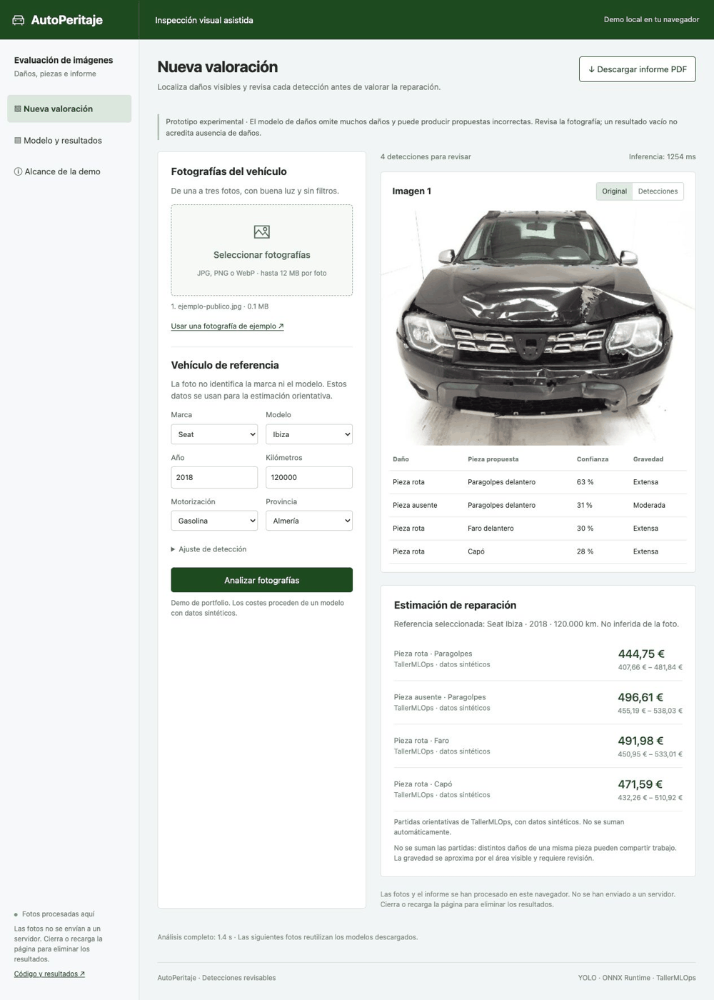
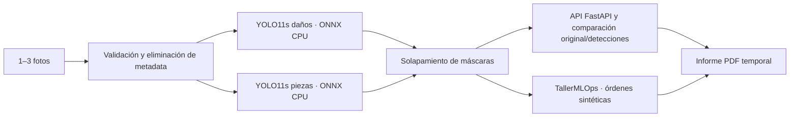
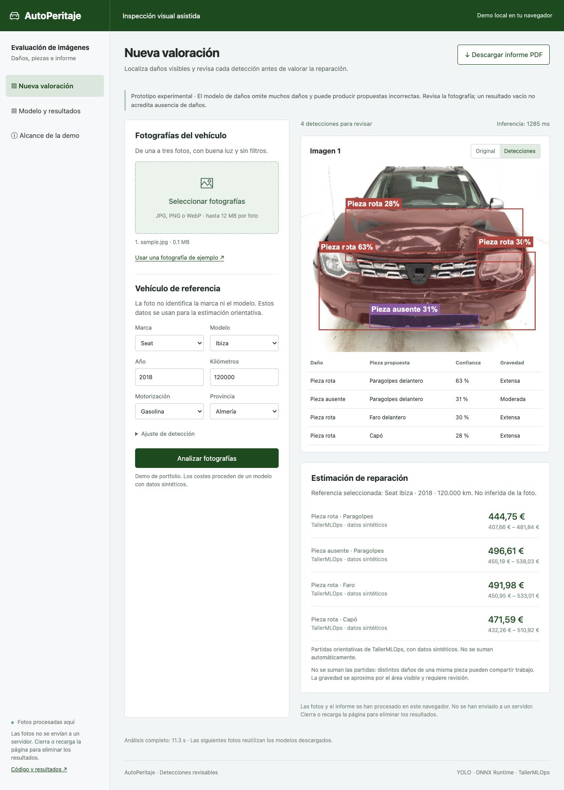

# AutoPeritaje

Una foto de un coche, sus daños visibles sobre la imagen y un informe PDF. Dos modelos YOLO separan daños y piezas; ONNX ejecuta el análisis en CPU y TallerMLOps aporta estimaciones orientativas con datos sintéticos.

**[Abrir demo gratuita en Hugging Face](https://huggingface.co/spaces/LaskyOp/AutoPeritaje)** · [Pantalla completa](https://laskyop-autoperitaje.static.hf.space/index.html) · [Resultados y errores](docs/evaluation.md) · [Arquitectura](#cómo-está-organizado)



**Estado del modelo:** prototipo experimental. El experto s de la API obtiene **9,20 % de mAP50 de máscaras** en prueba interna y el n de la demo web, **9,85 %**. El experto de piezas obtiene **86,25 %**, medido por separado. La demo permite estudiar el flujo completo, pero omite muchos daños y produce propuestas incorrectas. Una fotografía sin detecciones no acredita que el coche esté bien.

## Qué puedes probar en un minuto

1. Pulsa «Usar una fotografía de ejemplo» o selecciona de una a tres fotos.
2. Introduce el vehículo de referencia; la foto no identifica su marca ni modelo.
3. Analiza y alterna entre original y detecciones. Comprueba cada propuesta y la pieza asignada.
4. Consulta las partidas orientativas y descarga el PDF. No se suman automáticamente: varios daños de una pieza pueden compartir reparación.

La foto de ejemplo y las capturas proceden del dataset público, no de archivos personales. La demo no necesita claves ni servicios de pago.

La versión web gratuita procesa las fotos dentro del navegador: YOLO11n para daños, YOLO11s para piezas, presupuesto LightGBM de TallerMLOps y PDF local. La API conserva el experto s de daños. [Funcionamiento y comprobaciones de la versión estática](web-demo/README.md).

## Arranque local

Con Docker Desktop o Docker Engine y Compose:

```bash
git clone https://github.com/PedroFlores199/AutoPeritaje.git
cd AutoPeritaje
docker compose up --build
```

Abre **http://localhost:5106**. La primera construcción descarga dos modelos ONNX y una revisión fija de TallerMLOps; verifica sus huellas antes de utilizarlos. No descarga PyTorch ni necesita GPU. La configuración local publica el puerto exclusivamente en el propio ordenador.

Para ejecutar solo el analizador desde Python 3.12 y uv:

```bash
uv sync --extra test --frozen
uv run python scripts/download_models.py
uv run uvicorn peritaje.main:app --host 127.0.0.1 --port 5106 --no-access-log
```

En este modo, TallerMLOps se consulta en `http://localhost:5105`. Si no está disponible, el análisis y el PDF siguen funcionando; las partidas sin estimar se indican expresamente. El contenedor incluye la revisión verificada del servicio y lo llama mediante su API ASGI, dentro del mismo proceso. La demo estática de Hugging Face ejecuta los árboles exportados de ese mismo modelo en JavaScript, con paridad comprobada.

## Cómo está organizado



| Carpeta | Contenido |
|---|---|
| `training/` | Limpieza de polígonos, particiones por SHA-256, auditoría de cobertura, entrenamiento, evaluación y exportación. |
| `peritaje/` | API, inferencia ONNX, asignación de piezas, tratamiento de fotos e informe. |
| `peritaje/static/` | Interfaz verde y blanca, sin dependencias externas en el navegador. |
| `models/` | Manifiesto y huellas de los pesos; los binarios se distribuyen en [models-v1](https://github.com/PedroFlores199/AutoPeritaje/releases/tag/models-v1). |
| `scripts/` | Descarga y comprobación de modelos y de TallerMLOps. |
| `tests/` | Geometría, archivos, límites, caducidad, informes e integración con los modelos reales. |
| `web-demo/` | Variante estática: inferencia WebAssembly, modelo de presupuesto y PDF, sin subir las fotos a una API. |
| `docs/` | Métricas por clase, matriz de confusión, ejemplos de errores y capturas. |

## Comparación medida

Daños: 604 imágenes de entrenamiento, 98 de validación y 112 de prueba. Mismos identificadores y configuración para ambos tamaños, con hasta 80 épocas, parada temprana y semilla 42.

| Experto de daños | mAP50 máscaras · validación | mAP50 máscaras · prueba | mAP50–95 máscaras · prueba | CPU mediana |
|---|---:|---:|---:|---:|
| YOLO11n-seg | 12,63 % | 9,85 % | 4,68 % | 77,22 ms |
| YOLO11s-seg | **14,49 %** | 9,20 % | 4,34 % | 216,08 ms |

Se eligió **s por validación**, antes de evaluar la prueba final. En prueba generaliza peor que n; se conserva esa decisión para mostrar el resultado completo. La mAP es una medida de segmentación por clase, no un porcentaje de fotos correctamente peritadas.

El experto de piezas usa 21 clases y alcanza 86,25 % de mAP50 de máscaras sobre 133 fotos internas de prueba. Su mediana CPU es 226,60 ms. Estos valores no mejoran ni sustituyen la métrica de daños. Los tiempos son del motor ONNX con entrada 640 × 640, dos hilos, tres calentamientos y doce repeticiones en Mac M2 Max; no incluyen subida, máscaras, presupuesto ni PDF. [Medidas completas](docs/damage-test.json) y [comprobación de exportación](docs/onnx-parity.json).

## Datos y una dificultad real

Fuente: [DrBimmer/car-parts-and-damage-dataset](https://huggingface.co/datasets/DrBimmer/car-parts-and-damage-dataset), revisión fija `2dbf46f7e23eb0d6f551d38e4f77a11fe9d045b9`, declarada MIT por su publicador. De 1.812 archivos se obtienen 1.371 imágenes únicas agrupando coincidencias exactas antes de dividir.

Los nombres de las dos carpetas de origen no coincidían con sus anotaciones. Además, una foto anotada solo con piezas no demuestra ausencia de daños. La preparación final infiere la cobertura desde `classTitle`, conserva la partición global y entrena daños solo con imágenes anotadas para esa tarea. [Auditoría](docs/annotation-coverage.json).

No hay negativos limpios verificados, ni separación garantizada por vehículo o por serie de fotografías. Los subconjuntos internos se han utilizado durante el desarrollo; no son una evaluación externa independiente. El experto de piezas procede de un modelo conjunto anterior y descarta todas sus salidas de daños. El siguiente paso útil sería revisar las anotaciones, incorporar coches limpios y evaluar en vehículos diferentes.

## API y tratamiento de imágenes

La documentación interactiva está en `/docs`. `POST /api/analyze` recibe `files`, `vehicle_json` y `confidence`; devuelve las imágenes anotadas, daños, pieza, área y gravedad aproximada. `GET /api/reports/{id}.pdf` descarga el informe mientras el caso exista.

JPEG, PNG y WebP: hasta 12 MB por archivo, 20 megapíxeles al decodificar y reducción a 1.600 píxeles. El límite total también se comprueba en solicitudes sin tamaño declarado. La cola admite como máximo dos solicitudes y el análisis se serializa. La metadata se elimina al volver a codificar. Los archivos admitidos se mantienen en memoria durante el procesamiento; no se registran los nombres ni el contenido de las fotos. Hasta veinte casos, con caducidad de quince minutos y respuestas de la API sin caché. Reiniciar el proceso elimina los casos. El identificador del informe debe tratarse como un enlace privado temporal.

La gravedad depende del área visible, no de profundidad ni seguridad del vehículo. Las piezas sin solapamiento suficiente quedan sin determinar y no se valoran. Las partidas de TallerMLOps llevan intervalos orientativos de un modelo entrenado con órdenes sintéticas; no constituyen una factura.

## Validación y reproducción

```bash
uv sync --extra test --frozen
uv run python scripts/download_models.py
uv run pytest -q
```

Doce pruebas pasan con los modelos reales descargados. Sin los pesos, las pruebas de integración se marcan como omitidas. GitHub Actions ejecuta las comprobaciones y la construcción de la imagen. Para reproducir entrenamiento y evaluación: [guía](training/README.md). La matriz de confusión y los ejemplos incluyen resultados fallidos, con sus identificadores y criterio de selección.

La versión web añade cuatro pruebas de JavaScript, con paridad de 120 predicciones del modelo de presupuesto y máscaras de referencia de OpenCV. Se ha probado en el navegador con la foto pública, varias imágenes, una imagen vacía, un archivo dañado e informes de una y dos páginas. [Comprobaciones](docs/browser-validation.json) e [informe web](docs/example-web-report.pdf). La primera prueba local con los modelos y el informe completos tardó 2,2 s. La primera ejecución pública desde Hugging Face, incluida la descarga inicial, tardó 13,5 s en este Mac. Son observaciones del dispositivo, no garantías para otros equipos. [Prueba pública y despliegue sin servicios de pago](docs/huggingface-validation.json).



El Space sirve archivos estáticos preparados localmente; no utiliza compilación remota, GPU, claves ni un servidor de inferencia. [Preparación reproducible](deployment/huggingface/DEPLOYMENT.md).

Código y pesos derivados de YOLO bajo **AGPL-3.0**. Datos, fuentes y dependencias: [NOTICE.md](NOTICE.md).
