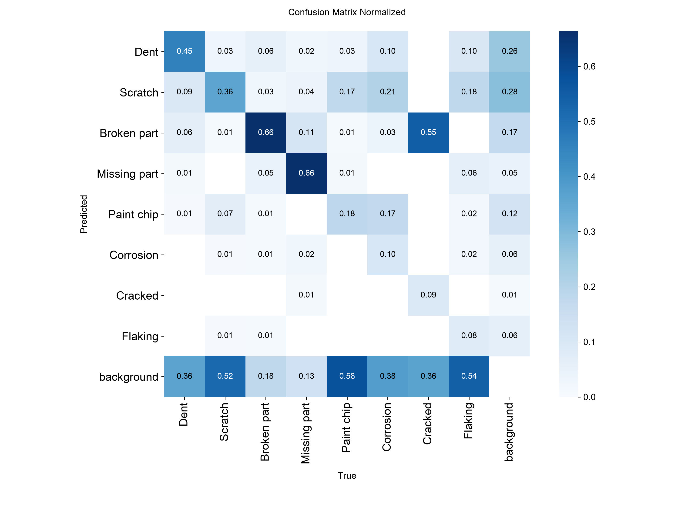
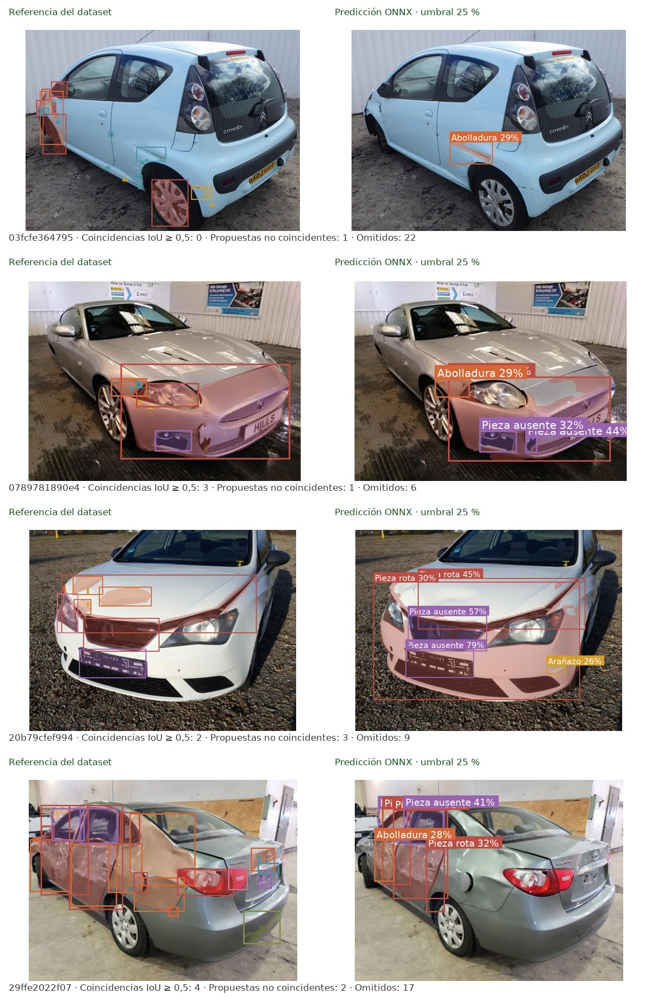

# Evaluación de AutoPeritaje

Resultados congelados de la ejecución final. Son medidas internas de segmentación; no equivalen a precisión por fotografía ni acreditan un peritaje profesional.

## Daños por clase

| Clase | Imágenes con esa clase | Instancias | Precisión de máscara | Recall de máscara | mAP50 máscara | mAP50–95 máscara |
|---|---:|---:|---:|---:|---:|---:|
| Dent | 84 | 266 | 18.25 % | 11.67 % | 6.39 % | 1.86 % |
| Scratch | 70 | 426 | 15.12 % | 7.98 % | 3.90 % | 1.10 % |
| Broken part | 85 | 199 | 25.72 % | 31.16 % | 19.19 % | 8.31 % |
| Missing part | 58 | 82 | 39.05 % | 50.00 % | 39.50 % | 21.72 % |
| Paint chip | 47 | 212 | 14.33 % | 4.25 % | 3.02 % | 0.76 % |
| Corrosion | 17 | 29 | 0.00 % | 0.00 % | 0.21 % | 0.07 % |
| Cracked | 8 | 11 | 6.35 % | 9.09 % | 1.26 % | 0.85 % |
| Flaking | 19 | 50 | 0.00 % | 0.00 % | 0.17 % | 0.04 % |

Las precisiones y recalls son los del evaluador Ultralytics con su punto operativo de F1; la mAP integra la curva de confianza. La interfaz usa por defecto 0,25, por lo que sus propuestas no tienen exactamente esa precisión o recall. [JSON completo](damage-test.json).

## Errores visibles

Las imágenes se seleccionan con un criterio fijo: primera por SHA que contiene Dent, Scratch, Cracked y Flaking, sin repetir foto. A la izquierda están las máscaras anotadas; a la derecha, las predicciones ONNX a 0,25. Los recuentos emparejan clase e IoU de máscara de al menos 0,5. [Identificadores y recuentos](error-examples.json).

- En la primera imagen, el modelo propone una abolladura pero omite la mayoría de los defectos pequeños anotados. La propuesta tampoco alcanza IoU 0,5 con la máscara de referencia de su clase.
- En la segunda y tercera, identifica parte de las zonas grandes, pero confunde huecos, pieza ausente y pieza rota, y omite detalles pequeños.
- En la cuarta, las propuestas gruesas del lateral dejan fuera muchos arañazos, pintura y grietas anotadas.

Las anotaciones se fragmentan en numerosas regiones y las clases tienen pocos ejemplos y límites ambiguos. La ausencia de negativos limpios y de separación garantizada por vehículo limita la interpretación de estas métricas. Se necesita revisión de datos y una prueba externa antes de plantear un uso real.

## Piezas y rendimiento

El experto de piezas se evalúa por separado, sobre 133 imágenes con cobertura de piezas. Su mAP50 de máscaras es 86,25 %. Sus predicciones de daños se descartan. [Métricas de las 21 clases](parts-test.json).

[Paridad de los tensores PyTorch/ONNX](onnx-parity.json): los dos expertos pasan la comprobación en la foto pública de ejemplo con el mismo preprocesado. Esta comprobación no sustituye la evaluación de detecciones en todo el conjunto.

[Prueba del contenedor](container-smoke.json): CPU limitada a dos núcleos, ambos expertos y TallerMLOps incluido. Se ejecuta la foto de ejemplo y se obtiene un PDF real. [Informe](example-report.pdf).
